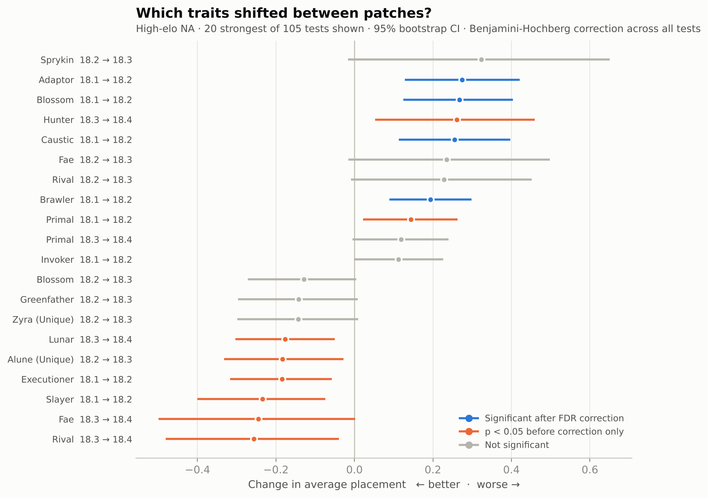
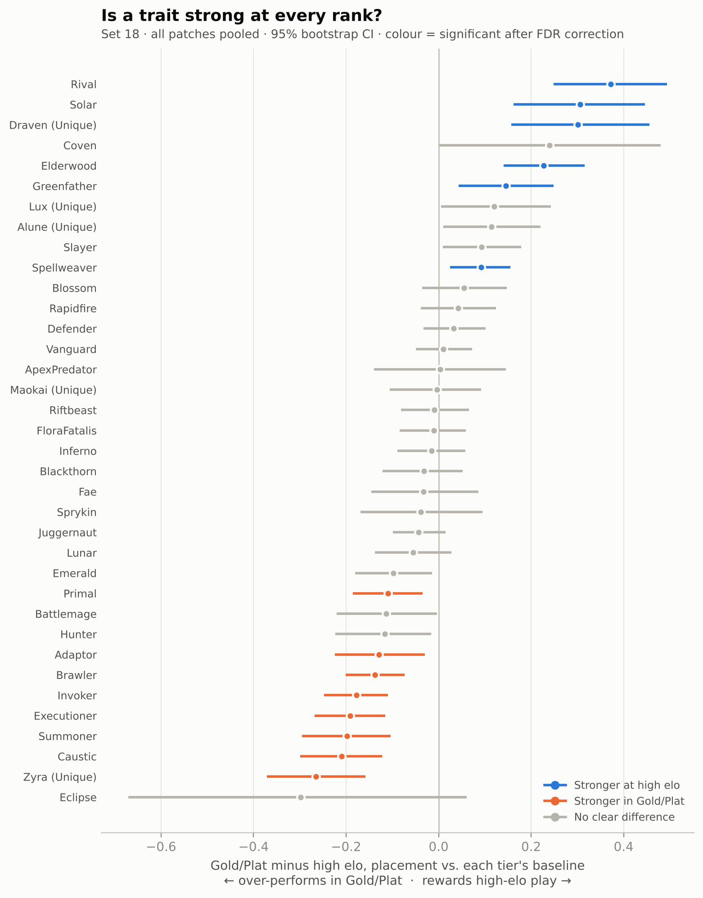
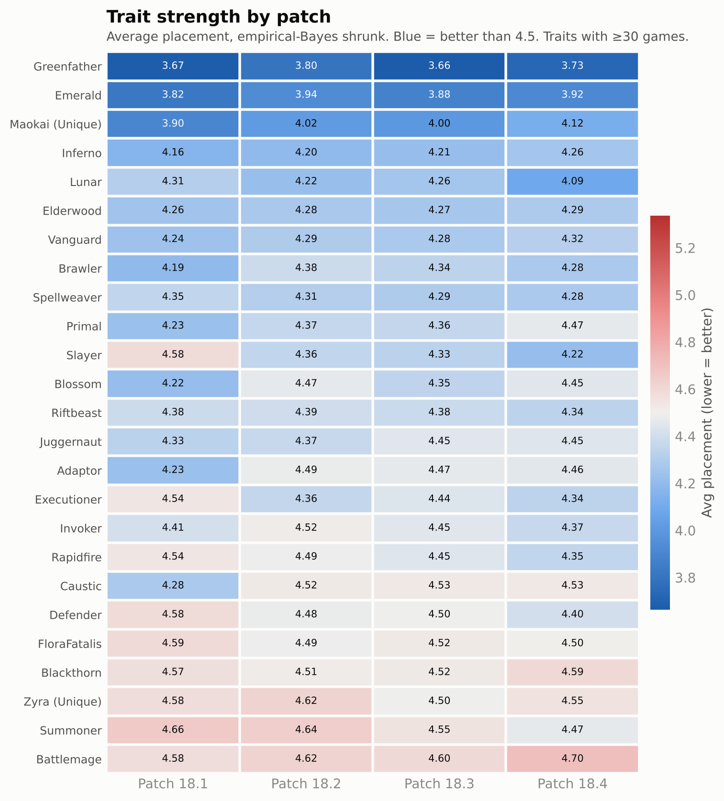

# TFT Meta Shift Detection & Rank-Gap Analysis

**Which balance patches actually change the high-elo *Teamfight Tactics* meta, and do traits that are strong at the top stay strong lower down the ladder?**

Using 7,411 ranked NA lobbies from Set 18 (patches 18.1–18.4), pulled from the Riot API:

- **Only one patch moved the meta.** In 18.2, Adaptor, Blossom, Caustic and Brawler each got **0.19–0.27 placements worse**, and all four survive false-discovery correction across 105 tests. Patches 18.3 and 18.4 produced no shift that survives it.
- **The shifts weren't direct trait changes.** None of the four was changed at the trait level in 18.2. The analysis caught side effects instead, such as a bug fix that stopped 2-star Adaptor copies from counting their traits twice.
- **Traits play differently by rank.** 14 of 36 traits perform differently in Gold/Plat than in high elo. Rival is 0.37 placements relatively weaker in Gold/Plat, and Zyra is 0.27 relatively stronger.



## Why this matters for balance

High-elo players find the strongest lines first, so their results are the earliest signal that a patch changed something. But a raw drop in average placement can be noise, or a side effect of *who* plays a trait. This project separates real shifts from variance, and checks whether each one survives controls for player skill and how far a board leveled.

A change sized for the top of the ladder can also land very differently lower down. The rank-gap analysis measures that directly.



## Results

### 18.1 → 18.2 shifts (high elo)

| Trait | Δ avg placement (95% CI) | Top-4 rate | FDR q | Holds vs. player skill | Holds vs. final level |
|---|---|---|---|---|---|
| Adaptor | +0.27 (+0.13, +0.42) | 56% → 51% | 0.01 | ✓ | ✓ |
| Blossom | +0.27 (+0.13, +0.40) | 55% → 50% | 0.01 | ✓ | ✓ |
| Caustic | +0.26 (+0.11, +0.40) | 55% → 51% | 0.02 | ✓ | ✓ |
| Brawler | +0.19 (+0.09, +0.30) | 56% → 52% | 0.01 | ✓ | ✗ |
| Slayer | −0.23 (−0.40, −0.07) | 48% → 53% | 0.09 | ✓ | ✓ |
| Executioner | −0.19 (−0.32, −0.06) | 48% → 53% | 0.10 | ✓ | ✓ |

Positive = worse. Slayer and Executioner improved, but just miss the 5% FDR cutoff.

### Trait strength by patch



### What didn't hold up

An earlier version of this project, built on Set 17, claimed that placement variance compresses as high-elo players converge on a patch. With balanced early/mid/late sampling in Set 18, variance fell for only 3 of the 13 shifted traits, so that claim is dropped.

## Methodology

1. **Collection** (`src/pipeline.py`)
   - Samples Challenger/Grandmaster players and a Gold/Platinum comparison sample.
   - Pulls each player's games inside *each* patch window, split into early, middle and late thirds, so every patch gets its own sample instead of only the most recent games.
   - Rate-limited for the Riot dev-key limits.
2. **Patch assignment** (`src/utils.py`): Set 18 match data no longer reports a patch number (`TFT Unreal Version ?.?.?.?`), so games are dated against Riot's published patch schedule. Games within 12 hours of a patch change are dropped.
3. **Cleaning** (`src/features.py`): drops incomplete lobbies and lobbies containing bots.
4. **Placement-aware statistics** (`src/stats.py`)
   - Average placement, top-4 rate and win rate, each with a 95% CI (t-interval / Wilson).
   - Patch-to-patch shifts tested with permutation tests (10,000 permutations).
   - Effect sizes: a bootstrap CI on the placement change, Cohen's d, and Cliff's delta.
   - **Benjamini–Hochberg FDR** and Holm corrections across all tests.
   - **Empirical Bayes shrinkage** (normal–normal for placement, beta–binomial for rates), so rarely played traits don't produce extreme estimates.
   - **Selection-bias checks:** player fixed effects (each game vs. that player's own average, for players with ≥5 games), and a level-adjusted difference-in-differences.
   - **Rank gap:** each trait is centered on its own tier-and-patch baseline before tiers are compared. This matters because losing boards in lower tiers activate fewer traits, which drags down every trait's raw average there.
5. **SQL** (`src/database.py`, `sql/`): a normalised SQLite schema (matches, participants, traits, units) and five analysis queries using CTEs and window functions. The SQL results are cross-checked against the Python output.
6. **Outputs:** static charts (`src/charts.py`) and Tableau-ready extracts (`src/export_tableau.py`).

## Data

| Sample | Lobbies | Seed players |
|---|---|---|
| High elo (Challenger + Grandmaster) | 4,557 | 100 |
| Platinum | 1,491 | 60 |
| Gold | 1,363 | 60 |

NA region, Set 18 patches 18.1–18.4, collected October 19, 2026. The raw data is in `data/raw/matches_v2.csv`. The original Set 17 data (`matches.csv`) is kept for reference.

## Limitations

- **Today's ladder:** "high elo" means players in Challenger or Grandmaster on the collection date, applied back to 18.1.
- **Lobbies treated as independent:** players in the same lobby are treated as independent games, which makes borderline results (q near 0.05) less certain than they look.
- **Final level is partly an outcome:** a board that wins levels further, so the level adjustment is a robustness check, not a causal control.
- **Patch boundaries:** B-patches and mid-patch updates are folded into their parent patch.
- **Traits only:** the unit of analysis is the trait. Clustering boards into full compositions would capture how traits interact.
- **Augments unavailable:** augment data isn't in the current API response, so opening augments can't be controlled for.

## Project structure

```
TFT-Meta-Analysis/
├── data/
│   ├── raw/              # Riot API match data
│   └── processed/        # stats outputs (shift tests, trait summary, tier gaps)
├── figures/              # README charts
├── sql/                  # schema + analysis queries
├── src/
│   ├── api.py            # Riot API client with rate limiting
│   ├── pipeline.py       # data collection
│   ├── utils.py          # parsing + patch calendar
│   ├── features.py       # cleaning + trait time series
│   ├── analysis.py       # original shift detection + stabilization
│   ├── stats.py          # placement stats, FDR, empirical Bayes, bias checks, rank gap
│   ├── database.py       # SQLite build + query runner
│   ├── charts.py         # static figures
│   └── export_tableau.py # Tableau extracts
├── tableau/              # Tableau data + build guide
└── tests/                # unit tests for the statistics
```

## Reproduce

```bash
pip install -r requirements.txt

# Collect (needs RIOT_API_KEY in .env; dev keys expire every 24h)
python -m src.pipeline --set 18 --tiers HIGH_ELO --players 100 --per-patch 15
python -m src.pipeline --set 18 --tiers GOLD PLATINUM --players 60 --per-patch 9

# Analyze
python -m src.features
python -m src.analysis
python -m src.stats
python -m src.database
python -m src.export_tableau
python -m src.charts
python -m pytest -q
```

Run any SQL query by its prefix: `python -m src.database --run 05`.
